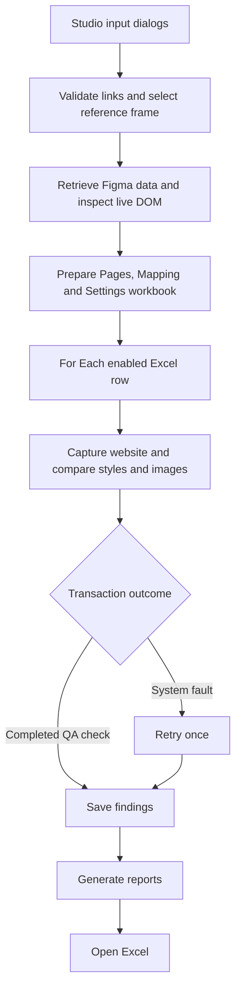

<div align="center">

# DesignQA

### Design checks, orchestrated in UiPath Studio

Compare Figma designs with a published website, review visual and styling differences, and open the results in Excel.


[Get started](#get-started) · [Choose a workflow](#choose-a-workflow) · [Verified results](#verified-results) · [Studio walkthrough](uipath/DesignQAAutomation/README.md)

</div>

---

## What DesignQA does

**UiPath drives the process.** Studio collects the inputs, prepares the Excel configuration, iterates through checks, handles technical retries, and displays report locations. Python retrieves design data, captures the website, compares images and styles, and returns structured results.

- Compare typography, colours, corner radius, dimensions and alignment where both sources expose the values.
- Capture a website at the selected Figma frame's viewport dimensions.
- Review screenshots and highlighted differences alongside an SSIM similarity score.
- Create Excel, HTML and JSON evidence for investigation.
- Compare two saved Figma frames through a separate Studio workflow.
- Keep related frame measurements together while preserving the full measurement record.

The React dashboard is an optional interface. The Studio project runs independently of the web server.

## Choose a workflow

| | Main.xaml | FigmaFrameComparison.xaml |
| --- | --- | --- |
| **Purpose** | Figma design versus a published website | Two exported frames from one Figma file |
| **Inputs** | Figma design URL and website URL | Figma design URL |
| **Design access** | Figma API using FIGMA_TOKEN | A matching saved export bundle |
| **Selection** | Linked frame, saved default, or a frame picker | Reference and comparison in the export bundle |
| **Excel** | Studio orchestrates Python report generation and opens Excel | Studio creates and populates Excel through Excel automation |
| **Output** | HTML, Excel, summary and row JSON, images | Excel, comparison JSON and difference image |

A Figma page can contain several designs. Main uses a specific frame when the link identifies one. For another multi-frame file, choose the intended reference in the picker. Saved defaults for the supplied example files live in [figma_frames.json](config/figma_frames.json).

## Get started

### 1. Prepare the machine

Use Windows, UiPath Studio with Windows/Visual Basic project support, Microsoft Excel desktop, and Python with a compatible Chromium installation. Python 3.14.7 was used for verification.

Run these commands once from the repository root.

```powershell
python -m venv .venv
.\.venv\Scripts\python.exe -m pip install -r backend/requirements.txt
.\.venv\Scripts\python.exe -m playwright install chromium
```

### 2. Configure Figma access for Main

Create a Figma personal access token with **file_content:read** access. Save it as a Windows **user environment variable** named `FIGMA_TOKEN`.

The bridge reads that user variable even when Studio was started earlier. Keep the token out of the URL fields, worksheets, repository and logs. The Figma connection in a chat uses its own authentication.

### 3. Open the Studio project

Open [uipath/DesignQAAutomation/project.json](uipath/DesignQAAutomation/project.json), double-click the workflow you want, and press **F6 — Debug File**.

For **Main.xaml**, enter these verified example inputs.

| Dialog | Example value |
| --- | --- |
| Figma design URL | `https://www.figma.com/design/jBFz1c5xbu8mYP7FCSdQwE/Untitled?node-id=1-2` |
| Website URL | `https://boar-serve-28825024.figma.site` |

The example's page link with `node-id=0-1` also works through its saved reference default. A website URL comes from the developer or the hosting dashboard for the implemented site.

Studio compares each enabled row, creates the reports and opens the findings workbook. A QA **FAIL** means the comparison found differences. Execution errors appear separately.

### 4. Run the saved-frame demonstration

Open **FigmaFrameComparison.xaml**, press **F6**, and enter the example file URL.

```text
https://www.figma.com/design/jBFz1c5xbu8mYP7FCSdQwE/Untitled?node-id=0-1
```

This requires a matching export bundle in a direct child of `Output/`.

```text
Output/<bundle-name>/
├── source-nodes.json
└── images/
    ├── design.png
    └── comparison.png
```

The bundle contains the file key, two frame trees and their exported images. User design exports and generated runs are excluded from Git. Supply an authorized bundle after cloning, and refresh it after changing the design. The frame workflow currently reads these saved exports.

## Inside the automation



Python business errors are recorded without transaction retries. System faults can be retried once by Studio. Generated Studio workbooks disable Python's internal row retries so Studio owns that retry decision.

The project uses named sequences following REFramework stages. A full REFramework state-machine implementation remains future work.

## Read the results

### Live website reports

Each run is stored under `Output/uipath/studio_<id>/`.

| Artifact | Contents |
| --- | --- |
| Input/pages.xlsx | Pages, Mapping and Settings used for that run |
| transactions.log | Row, exit code and transaction classification |
| rows/*.json | Detailed per-check evidence |
| images/ | Reference, website capture and highlighted difference |
| findings.xlsx | Findings and Summary worksheets |
| report.html | Self-contained visual report |
| summary.json | Run totals and output paths |

Automatic mapping ranks text, layer names, accessible labels and semantic elements. Only high-confidence suggestions are applied by the Studio bridge. Review mapping coverage because generic or ambiguous layers can remain unverified. The optional website supports manual mapping corrections.

### Frame comparison reports

UiPath creates a new workbook under `Output/uipath/figma_<id>/`.

- **Findings** lists primary findings and their related measurements.
- **Measurements** retains every original finding.
- **Summary** records the verdict, similarity and counts.

A reduced heading can shift several nearby elements. The report groups typography dimensions and consistent flow shifts inside the same container. Independent position changes remain separate. This is a measured relationship, and does not establish the underlying CSS cause.

## Verified results

| Scenario | Observed result |
| --- | --- |
| Brewly baseline at 1440 and 375 px | PASS, zero findings, SSIM 1.0 |
| Brewly seeded defects | All five desktop defects detected; four active defects detected on mobile |
| Flipkart saved frame comparison in Studio | Excel created and opened by UiPath |
| Optimized Flipkart frame report | 6 primary findings with all 14 original measurements retained |
| Authenticated Figma versus published app through Main | Executed in Studio, 14 mapped elements, reports generated and Excel opened |
| Automated regression suite | 15 tests passed |

The live run exposed text-to-container matching errors that were corrected. Additional checks cover direct text matching, modern browser colour conversion, padded control text, frame selection, exception handling and grouped measurements.

See [UiPath verification](docs/UIPATH_VERIFICATION.md) and [web verification](docs/WEB_TEST_RESULTS.md) for the scope of each check. Historical files in `sample_output/` are demo evidence from the original project.

## Optional web dashboard

Requires a Node.js version compatible with Vite 8.

```powershell
powershell -ExecutionPolicy Bypass -File .\run_web.ps1
```

Open `http://127.0.0.1:8000`. The launcher installs dependencies, builds the frontend and serves the dashboard with FastAPI. It includes history, progress, frame review, mapping review, visual comparisons and report downloads.

[Frontend instructions](frontend/README.md) · [Web architecture](docs/WEB_ARCHITECTURE.md)

## Project map

```text
uipath/       Studio project and Python integration bridges
scripts/      Existing capture, comparison and report engine
config/       Workbook template and saved reference-frame defaults
demo/         Brewly baseline and seeded-defect fixture
backend/      Optional FastAPI jobs, mapping and persistence
frontend/     Optional React, TypeScript and Tailwind dashboard
tests/        Automated regression checks and browser smoke test
docs/         Architecture and verification records
sample_output/ Historical demo reports
Output/       Local runtime evidence, excluded from Git
```

## Run the checks

```powershell
.\.venv\Scripts\python.exe -m unittest discover -s tests -v
```

With the optional web server running, execute the browser smoke test.

```powershell
.\.venv\Scripts\python.exe tests/browser_smoke.py -v
```

The existing CLI remains available for configured workbook runs.

```powershell
.\.venv\Scripts\python.exe scripts/run_qa.py --list
.\.venv\Scripts\python.exe scripts/run_qa.py --row 2 --run-id example
.\.venv\Scripts\python.exe scripts/run_qa.py --report --run-id example
```

## Scope and limitations

Supported sources are accessible Figma Design/File URLs and public HTTP(S) websites. File permissions, token expiry, network access and screenshot limits apply.

Line height, border colour, explicit spacing, unexpected DOM elements and unmapped checks remain unverified. Rendering can vary with installed fonts and browser versions. SSIM is measured over the common image area after width normalization, with page-height differences reported separately. Dynamic content can be excluded with HideSelectors in the internal Settings sheet.

The optional web application is intended for a local, single-user workspace. Login-protected websites, animation testing and automatic code fixing are outside the current scope.
