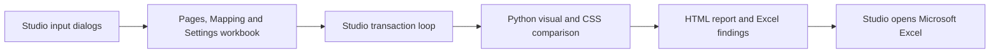

# Design-vs-Live QA Bot

**UiPath Studio · Python · Playwright · Excel**

[Studio walkthrough](uipath/DesignQAAutomation/README.md) · [Web architecture](docs/WEB_ARCHITECTURE.md) · [Verification results](docs/WEB_TEST_RESULTS.md)

Compares a Figma design (or exported mockup) with the live website at several screen sizes and reports
exactly where the build drifts from the design - **pixels** (SSIM + red overlay) *and* **design tokens**
(font, size, weight, colours, corner radius, size/position). UiPath orchestrates; Python does the
screenshots, image diff and Figma API calls.

## Primary workflow in UiPath Studio

Open [the UiPath project](uipath/DesignQAAutomation/project.json) and select the workflow below. Double-click its XAML file in Studio Explorer and press **F6 (Debug File)** to run that selected file.

| Workflow | What it compares | Inputs |
| --- | --- | --- |
| `Main.xaml` | A selected Figma reference frame with the implemented website | Figma frame URL and deployed website URL. Requires one-time token setup. |
| `FigmaFrameComparison.xaml` | Two saved exports from the same Figma file | Figma file URL. Requires a matching local export bundle. |

For the current Flipkart frame demonstration, open `FigmaFrameComparison.xaml`, press **F6**, and paste:

```text
https://www.figma.com/design/jBFz1c5xbu8mYP7FCSdQwE/Untitled?node-id=0-1
```

The workflow looks for a matching `source-nodes.json` and both frame PNGs in a direct child of `Output/`. The verified local bundle is `Output/flipkart-figma-verification`. Runtime exports are excluded from Git to keep user design data out of the source repository. A fresh checkout needs an authorized export bundle before this demonstration can run. Re-export after editing the Figma frames.

For `Main.xaml`, select the intended reference frame in Figma and choose **Copy link to selection**. Paste that frame link in the first dialog. Paste the URL of the corresponding implemented website in the second dialog. Obtain that address from the developer or the deployment dashboard, such as Vercel, Netlify or GitHub Pages. The chosen frame's width is detected automatically. A Figma page containing several frames needs a frame-specific link.

Set `FIGMA_TOKEN` once as a Windows user environment variable using a Figma personal access token with file content read access. Keep it out of the links, worksheets and Git. The bridge can read the Windows user variable even if Studio was started earlier. Connecting Figma in this chat gives the chat tools access independently of the local UiPath Robot.

When the run completes, Studio opens the findings workbook in Microsoft Excel. The [Studio walkthrough](uipath/DesignQAAutomation/README.md) covers Windows setup, each activity group, Figma credentials and frame selection, and the generated Excel and HTML files.



## Optional web application

DesignQA runs locally as a React dashboard with a FastAPI worker. At setup, install Python and a Node.js version compatible with Vite 8. On Windows, run the launcher from this folder.

```powershell
powershell -ExecutionPolicy Bypass -File .\run_web.ps1
```

Open [DesignQA](http://127.0.0.1:8000). The launcher installs dependencies, builds the frontend and serves it with the API. To restart an existing installation, run `.\.venv\Scripts\python.exe -m uvicorn backend.app:app --host 127.0.0.1 --port 8000`.

- To try the workflow, choose **New analysis → Demo analysis** and select **Clean baseline** or **Seeded defects**. Choose desktop, mobile, or both.
- For a live check, paste a Figma design URL and its corresponding public website URL. Supply a Figma token with `file_content:read` access or configure `FIGMA_TOKEN` in the server's environment. Confirm the breakpoint frames and review the suggested CSS selectors. Clear a selector to skip the layer.
- Open the check for each breakpoint to inspect findings, compare screenshots, or download HTML, Excel and JSON. History and approved mappings persist under `Output/web`. Set `DESIGNQA_OUTPUT` to use another directory.
- The current web form compares one live page per job, with up to two viewport checks. Coverage lists unavailable checks. Line height, border colour, spacing, and unexpected elements are unverified. The local server is intended for a single-user workspace.

Run the API tests with `python -m unittest discover -s tests -v`. With the local server running, run `python tests/browser_smoke.py -v` to exercise the production bundle through to a real report download. The test uses the environment where the dependencies are installed.

See [the web architecture](docs/WEB_ARCHITECTURE.md), [frontend setup](frontend/README.md), and [web test results](docs/WEB_TEST_RESULTS.md).

## Existing command-line workflow

## 1. Setup (once)
```bash
pip install -r requirements.txt
python -m playwright install chromium
```

## 2. Try the demo (no Figma needed)
```bash
python demo/make_demo.py                    # builds demo sites, simulated design export, config/pages.xlsx
python scripts/run_qa.py --all              # runs all enabled rows, builds the report
```
Open `Output/<run_id>/report.html` (also `findings.xlsx`).
Expected: `Home_Baseline` passes; `Home_Buggy` fails with the 5 seeded bugs found (font size, button colour,
card radius, missing badge, shifted subtitle). The font-size bug exists only in the desktop CSS, so it is
(correctly) reported at 1440 px and not at 375 px.

## 3. Use it on your own project (Figma mode)
1. Get a Figma personal access token and set it: `set FIGMA_TOKEN=xxxx` (Windows) / `export FIGMA_TOKEN=xxxx`.
2. In Figma, make one frame per breakpoint, **frame width = breakpoint** (e.g. 1440, 375).
3. In `config/pages.xlsx` > **Pages**: fill `FigmaFileKey` (from the file URL), `FigmaNodeId` (frame id, e.g. 12:34),
   `LiveURL`, `Breakpoint`; leave `DesignImage`/`DesignStyles` empty.
4. In **Mapping**: one row per element - `Label`, the element's Figma node id, and its CSS selector.
5. Run `python scripts/run_qa.py --all`.

## 4. Command reference
| Command | Purpose |
|---|---|
| `run_qa.py --list` | JSON list of enabled rows (UiPath loops over this) |
| `run_qa.py --row N --run-id R` | process one Pages row (one UiPath transaction) |
| `run_qa.py --report --run-id R` | merge row results into report.html + findings.xlsx |
| `run_qa.py --all [--only PageName]` | everything in one go |

Exit codes: `0` all pass, `1` differences found, `2` a row could not be processed.
Stdout = one JSON object; logs go to stderr.

## 5. Severity rules
| Finding | Severity |
|---|---|
| Element missing on live page; font family differs | High |
| Font size / weight / colour / background off by more than tolerance; position/size off by >12 px; low SSIM | Medium |
| Corner radius; position/size off by 4-12 px; small changed regions | Low |

Tolerances live in the **Settings** sheet. A page is **FAIL** if it has any High or Medium finding.

## 6. Files
```
config/pages.xlsx        Pages / Mapping / Settings / Legend
scripts/run_qa.py        orchestrator CLI          scripts/capture.py   Playwright screenshot + computed styles
scripts/diff.py          SSIM + overlay            scripts/compare_styles.py  token/layout comparison
scripts/figma_client.py  Figma REST API client     scripts/report.py    HTML + Excel report
demo/                    demo sites + simulated design export
uipath/UIPATH_GUIDE.md   how to wire this into UiPath (REFramework)
sample_output/           a real report generated from the demo
```

## 7. Known limits
- Needs the Mapping sheet (design element -> CSS selector). Auto-mapping from layer names is future work.
- Dynamic content (ads, carousels, dates): add selectors to `HideSelectors`.
- Fonts must be installed/loaded on the machine, or the screenshot will use fallbacks (the style check still compares declared fonts).
- `figma_client.py` follows the public Figma REST API docs but was not run against a live Figma file while building this - test it with your own file/token first.
- Pages behind a login need a login step added in `capture.py` (or a UiPath login before capture).

