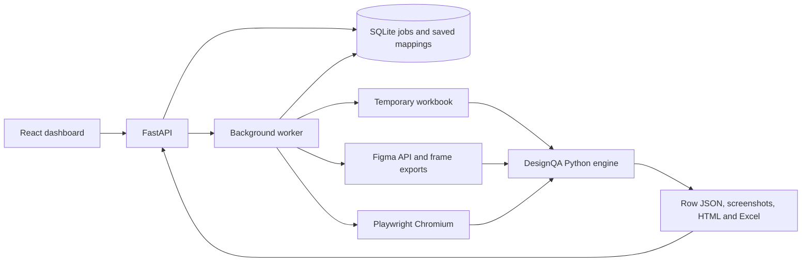

# DesignQA web application architecture

## Phase 1 findings

The existing Python project has a working local comparison pipeline. The [project audit](../PROJECT_AUDIT.md) inventories the source and workbook. The browser workflow will start from a Figma URL and a live URL, offer frame and mapping review where needed, run the comparison in the background, and present the evidence in a dashboard. The workbook remains an internal adapter. The existing CLI and UiPath integration guide can still use their original workbook.

| Existing module | Web integration |
| --- | --- |
| `run_qa.py` | Generate a per-job workbook, load it with `load_config`, execute each row with `process_row`, and aggregate row evidence with `build_reports`. Add optional stage callbacks and a capture hook for web workers while retaining CLI defaults. |
| `capture.py` | Reuse Chromium viewport, scroll, screenshot and computed-style capture. Share browser setup with live DOM inventory and ensure the same viewport and capture policy are applied in both steps. |
| `figma_client.py` | Reuse node normalization and `extract_tokens`. Add frame discovery and selected-frame metadata. Separate API authentication from export downloads and reuse per-job metadata between mapping and comparison. |
| `diff.py` | Reuse SSIM, changed regions, and highlighted difference images. Preserve dimensions so consumers can interpret width-normalized, cropped comparisons and separate page-height findings. |
| `compare_styles.py` | Reuse supported property comparisons and severities. Add explicit coverage metadata outside the existing findings schema. |
| `report.py` | Reuse HTML and Excel builders. Extend report metadata and recommendations for web jobs and serialize a public JSON result from row evidence. |

## Runtime design

Use React, TypeScript, Tailwind and Lucide for the dashboard, analysis form, frame and mapping review, progress, results, and comparison. Use a same-origin build in production and a development proxy. Host FastAPI on a conventional Python runtime with Chromium support. A static frontend can be hosted independently, with FastAPI and the browser worker still running on that Python host.

Start with a local or single-instance deployment and a bounded job executor. Keep timestamps, job status, result summaries, frame IDs, and approved mappings in SQLite. Keep screenshots and finalized reports under `Output/web/<job_id>/`, with distinct image and row paths per page and breakpoint. Build temporary workbooks in per-job directories and use unique internal row names because the existing engine keys mappings and image filenames by page name and width. Clean up temporary inputs after completion. A restart should mark interrupted jobs and let the user resubmit them. Requests waiting for review must supply the token again if the in-memory session expired.

The workbook adapter writes Pages, Mapping, and Settings using the current headers. For a confirmed frame, the worker can pass the already fetched PNG and normalized tokens as private local design assets. That lets the engine use its local-input path and avoids duplicate exports. Keep Figma provenance in the job metadata and reports. Preserve local CLI behavior for existing files.

## API and job lifecycle

| Endpoint | Purpose |
| --- | --- |
| `POST /api/analyze` | Validate input and enqueue a real or demo job. Accept the optional user token in the request body. Return 202 with a job ID and status URL. |
| `GET /api/analyze/{job_id}` | Return state, stage events, elapsed time, completed checks, safe errors, and frame or mapping review data. |
| `POST /api/analyze/{job_id}/frames` | Confirm a frame for each requested breakpoint and continue to DOM inspection. |
| `POST /api/analyze/{job_id}/mapping` | Approve, change, or skip suggested mappings and resume analysis. |
| `GET /api/results/{job_id}` | Return finalized page and breakpoint evidence, coverage, findings and summary. |
| `GET /api/history` | Return paginated run history and dashboard aggregates for the current workspace or authenticated owner. |
| `GET /api/reports/{job_id}?format=html` | Download an allowlisted artifact. Also accept `xlsx` and `json`. |
| `GET /api/results/{job_id}/images/{image_id}` | Serve a named comparison artifact associated with the job. |
| `GET /api/health` | Return application availability and basic worker readiness without exposing configuration secrets. |

Persist transitions through queued, running, awaiting frame selection, awaiting mapping review, completed, or failed. Emit progress from completed work for URL validation, Figma retrieval, element identification, live capture, screenshot comparison, style comparison, and report generation. Report per-breakpoint progress and retry attempts. For demo runs, indicate that local references are used. A completed job can contain QA failures or partial results from an unavailable breakpoint. Keep job completion, QA verdict, and coverage distinct. Return a structured business or technical error when an operation fails and retain successful breakpoint evidence.

## Figma frames and mapping

Parse standard Figma design and file paths with a strict Figma hostname check. Extract the file key, normalize an optional `node-id`, and verify its type and dimensions from the API. Use an explicit frame for a breakpoint when valid. Show candidate frame names, IDs, and dimensions when selection is needed. Suggest widths near 1440 or 375 px, and surface width differences for confirmation because rescaling affects SSIM and layout interpretation. Multiple frames can be selected across breakpoint checks. The first web form serves one live page, with page and breakpoint identifiers carried through results for future multi-page requests.

Collect candidate design layers and DOM nodes within bounded inventory sizes. Rank on normalized layer names, visible text, semantic role or tag, and accessible labels. Return the proposed selector, matching signals, and a confidence band. Request confirmation for ambiguous candidates. Check that a manually entered selector resolves uniquely at the intended breakpoint and show the matched node. Save approved mappings per workspace, file, frame, live page and breakpoint. Check saved selectors again on subsequent visits.

Keep unmapped design layers visible as unverified coverage. A previously approved selector that no longer resolves can produce a missing-element finding. Ambiguous selectors require review. A visual-only check can still run when all mappings are skipped. Support that case explicitly in the web adapter or a narrow engine option because the current row runner requires at least one mapping.

## Comparison coverage and reports

- **Supported by the current engine** includes font family, size and weight, solid text and background colors, corner radius, element dimensions, frame-relative position, target presence, SSIM, and changed regions when the required design and live data exist.
- **Requires more data** includes line height, border color, per-edge corner radii, and spacing. Spacing needs a comparable gap or padding measurement on both sides. Unexpected elements require an agreed DOM scope and expected inventory. Render unavailable checks as unverified.
- **Result presentation** includes per-breakpoint design, live and diff images, side-by-side views and a controllable overlay. Add category, label, expected and actual, numeric delta where meaningful, severity, and breakpoint. Preserve the engine's QA verdict rules so a low-severity radius issue can appear on a PASS.
- **Downloads** include web job provenance, timestamps, breakpoint status, coverage, severity, evidence and investigation notes. Reuse the self-contained HTML and Excel workbooks. JSON should include artifact URLs and stable IDs instead of server filesystem paths. Average similarity uses completed checks with an SSIM score.

## Credential and browser boundaries

Use a per-job token in memory or the server's `FIGMA_TOKEN` fallback. Send the API credential only to the Figma API origin. Download the returned image through a separate credential-free request with controlled redirects and a bounded response. Keep credentials out of browser storage, query strings, workbook cells, persisted job records, logs and downloaded artifacts. Use HTTPS for remote deployment and scope history, mappings, results, and downloads to the same authenticated owner. Treat live page content as untrusted and escape it in rendered outputs.

Before supporting user-submitted public URLs, put Chromium behind a controlled egress boundary. Enforce the public HTTP(S) destination policy across navigation, redirects, DNS resolution, and subresources. Use an isolated browser context with explicit runtime and file limits. Give demo mode a dedicated allowlisted local fixture path. Keep captures isolated from server workspaces and secrets. A shared deployment also needs job quotas and a retention policy for screenshots and reports.

## Phase 1 verification and next phases

Ran the existing engine on a fresh temporary archive extraction under Windows with Python 3.14.7 and Playwright 1.65.2. Regenerated reference PNGs and tokens in that copy, then verified `--list`, `--all`, and `--report`. Assertions checked per-row verdicts, seeded findings, screenshot files, embedded HTML images, and both Excel sheets. The run produced two PASS, two FAIL, and zero execution errors.

| Check | 1440 px | 375 px |
| --- | --- | --- |
| Baseline | PASS, zero findings, SSIM 1.0 | PASS, zero findings, SSIM 1.0 |
| Combined-bug page | FAIL, 14 findings, SSIM 0.9569 | FAIL, 13 findings, SSIM 0.9406 |
| Seeded detections | Font size, CTA color, card radius, missing badge, subtitle shift | CTA color, card radius, missing badge, subtitle shift. The mobile CSS overrides the seeded font change. |

The [prior verification run](../Output/verification_regenerated/windows/report.html) reproduced these results and remains available in the project. Generate demo references in the deployment's browser and font environment so shipped captures cannot introduce baseline drift.

1. Build the frontend views and typed API client using a request contract that exposes real stage and review states.
2. Build FastAPI request validation, job persistence, status and artifact endpoints.
3. Integrate the engine and prove the demo path through the API without manual workbook edits.
4. Implement real Figma frame discovery, credential handling, DOM inventory, and saved mapping review.
5. Wire live progress, the results dashboard, visual comparison, report downloads, and history.
6. Add automated tests for valid and malformed Figma inputs, missing credentials, invalid live URLs, transient network errors, mapping review, both viewport sizes, independent seeded style and layout defects, and downloaded artifacts. Run a browser end-to-end demo and an authenticated test with an accessible Figma file and corresponding live site.

The local implementation now serves the production React app and API together. See [web test results](WEB_TEST_RESULTS.md) for verified behavior and remaining coverage. The local Chromium request filter is a best-effort restriction. Shared deployment still needs a network-enforced egress boundary and authenticated workspace isolation.

